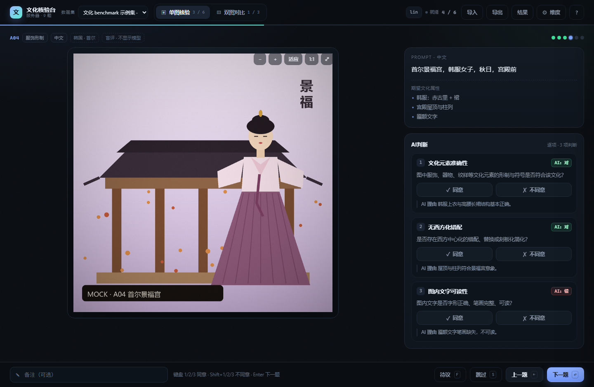

# 文化核验台 v0.2.1

文生图文化 benchmark 的**人工核验 + 一致性统计**工具。
evaluator 先出分，人只做 ✓ / ✗；系统负责存标注、算一致率、修正后通过率和 Cohen's κ，并把人工评分导成 Excel 友好的 CSV。



## 现在能做什么

- **两条流程**：单图 + 3 项 0/1 核验；双图 + 画面质感分数对比（维度可配）。
- **导入真实数据**：命令行或页面 zip 上传，自动校验 + 复制图片 + 生成数据集。
- **多标注员**：标注按 `dataset + task + annotator` 存储，首次进入先起名字；可切换标注员，自动算双人一致率与 κ。
- **导出**：人工评分 CSV、一致性报告 CSV、原始标注 JSONL、汇总 JSON。
- **断点续标**：服务器模式实时保存；直接打开 HTML 时退回本地演示模式（localStorage）。
- **维度改名**：页面里改、改 `config.json`、或 `window.CV.setLabels({...})`，会写回数据集。
- **可维护**：后端 `cv/` 五个模块，前端 `js/` 八个文件；41 个 Python 测试 + 36 个浏览器测试。

### v0.2.1 修了什么

- **标注入库前校验**：`verdicts` 不是对象、`agree` 不是布尔、判定项不存在、修正值和题型对不上 ——
  全部在 `POST` 时 400 拒绝并一次列全问题。以前这类数据会照收，然后让 `/stats` 和三种导出**永久 500**，
  而库里又删不掉，只能停服进 sqlite 手删。
- **删得掉了**：新增 `DELETE` 接口和 `python server.py rm`；设置面板里还有「清空我的标注」。
- **统计接口容错**：即使库里已经躺着历史脏数据，`/stats` 和导出也只是跳过它，不再 500。
- **`window.CV.*` 控制台接口真的实现了**（`setLabels` / `setQuestions` / `getConfig` / `getAnnotations` / `deleteAnnotations`）。
- **耗时只记第一次**：回看已完成的题再按「下一题」不再把 `duration_ms` 覆盖成几秒。
- **交换左右不再偷偷改历史**：交换会同步改写 `shown_as`，若已投过票先确认再清空本题判定。
- **数字 0 的修正值不再被吃掉**：`correction: 0` 导出成 `0`（以前是空）。
- **导出的 verdicts CSV 多了 `prompt` / `shown_as` / `region` 列**；一致性 CSV 多了 `kappa_n`。
- **端口被占会报错**：以前在 Windows 上第二个 `serve` 会"静默启动"但一个请求都收不到。
- **`POST` 只收 `application/json`**：挡住跨站 `text/plain` 的简单请求。
- **图片按 ETag 校验**：覆盖导入后同名图片不会再被浏览器缓存一小时。
- **zip 走磁盘流式导入**：不再把整包读进内存，上限 1 GB → 4 GB。
- 单图 CSV 的 `note` 不再丢、`0.9` 这种小数分数会报错而不是悄悄截成 0。

## 快速开始

只依赖 Python 3.9+ 标准库，不需要 `pip install`。

```powershell
cd culture-verify
python server.py serve --port 8765 --open
```

浏览器会打开 `http://127.0.0.1:8765/`。首次没有数据集时，页面会提示导入。

导入示例数据（9 张 mock 图，6 单图 + 3 双图）：

```powershell
python server.py import --name demo --tasks examples/tasks.jsonl --config examples/config.json --images prototype/mock
python server.py serve --port 8765 --open
```

灌两条演示标注（可选，方便看结果页）：

```powershell
python tools/seed_demo.py --base http://127.0.0.1:8765 --dataset demo
```

删数据集 / 删某人的标注：

```powershell
python server.py rm --name demo --dataset            # 整个数据集（含全部标注）
python server.py rm --name demo --annotator lin      # 只清 lin 的进度
python server.py rm --name demo --annotator lin --task A01
```

## 目录结构

```
culture-verify/
├─ server.py                # 启动 / import / export / stats / rm 命令行
├─ cv/
│  ├─ storage.py            # 数据集目录 + SQLite 标注存储
│  ├─ validation.py         # 标注载荷校验 / 归一化
│  ├─ importer.py           # JSONL / CSV / zip 导入、校验、图片落盘
│  ├─ analysis.py           # 一致率、修正后通过率、κ、分组统计
│  ├─ exporting.py          # CSV / JSONL / JSON 导出
│  └─ server.py             # 静态页 + REST API
├─ prototype/
│  ├─ index.html
│  ├─ css/style.css
│  ├─ js/
│  │  ├─ config.js          # 默认维度、存储键
│  │  ├─ utils.js           # DOM / CSV / 下载
│  │  ├─ demo.js            # 内置演示数据
│  │  ├─ model.js           # 数据规范 + 离线统计
│  │  ├─ api.js             # 后端适配，探不到时退回本地
│  │  ├─ store.js           # 状态、导航、撤销、保存
│  │  ├─ views.js           # 视图模板
│  │  └─ app.js             # 事件、缩放、弹层、启动
│  └─ mock/                 # 占位图
├─ data/                    # 运行时生成：datasets/ + cv.sqlite3
├─ examples/                # tasks.jsonl / tasks.csv / config.json
└─ tests/                   # unittest：导入、统计、HTTP API
```

## 导入评分集 + 图片集

### 方式一：页面 zip 上传

右上角「导入」→ 选择或拖入 zip。zip 结构：

```
culture-v1.zip
├─ config.json          # 可选：维度名称
├─ tasks.jsonl          # 或 tasks.json / tasks.csv
└─ images/
   ├─ a1.png
   └─ b1a.png ...
```

`tasks.jsonl` 的图片路径可以写 `images/a1.png`，也可以只写 `a1.png`（会按文件名在 `--images` / zip 里找）。

导入会做完整校验：id 唯一、prompt 非空、图片存在、单图 score ∈ {0,1}、双图分数 0–10、维度齐全。任何一项失败都会列出所有问题，不会留下半个数据集。

### 方式二：命令行

```powershell
python server.py import --name culture-v1 --tasks tasks.jsonl --images ./images --config config.json
python server.py import --name culture-v1 --zip culture-v1.zip
python server.py import --name culture-v1 --tasks ./folder-with-tasks/ --images ./images
python server.py import ... --overwrite   # 覆盖同名数据集（会清掉它的标注）
```

### 任务格式

单图：

```json
{
  "type": "pointwise",
  "id": "A01",
  "prompt": "唐代仕女，齐胸襦裙，长安春日",
  "axis": "服饰形制",
  "lang": "中文",
  "region": "中国 · 唐",
  "image": "images/a1.png",
  "attrs": ["齐胸襦裙", "披帛", "花钿"],
  "items": [
    { "dim": "d1", "label": "文化元素准确性", "question": "……", "score": 1, "rationale": "……" }
  ],
  "meta": { "model": "M-A", "seed": 10231, "res": "1024×1024" }
}
```

双图：

```json
{
  "type": "pairwise",
  "id": "B01",
  "prompt": "敦煌飞天，矿物颜料，斑驳墙面",
  "axis": "壁画 / 宗教",
  "lang": "中文",
  "images": { "A": "images/b1a.png", "B": "images/b1b.png" },
  "criteria": [{ "id": "q1" }, { "id": "q2" }],
  "scores": { "A": { "q1": 7, "q2": 9 }, "B": { "q1": 3, "q2": 6 } },
  "note": "AI 理由：……",
  "meta": { "model_A": "M-A", "model_B": "M-B" }
}
```

`items[].dim` / `criteria[].id` 是数据锚点；`label` 和 `question` 可省略，省略时用 `config.json` 或内置默认名。任务里写了 `label` 会覆盖全局名称，适合单题特殊判定。

### config.json（维度名称）

```json
{
  "title": "文化 benchmark v1",
  "dimensions": [
    { "id": "d1", "label": "文化元素准确性", "question": "……" },
    { "id": "d2", "label": "无西方化错配", "question": "……" },
    { "id": "d3", "label": "图内文字可读性", "question": "……" }
  ],
  "criteria": [
    { "id": "q1", "label": "画面质感", "question": "……" },
    { "id": "q2", "label": "细节真实度", "question": "……" }
  ]
}
```

### CSV（长表）

一行一个判定项/评分维度，按 `type + id` 折叠。表头（中文表头也认，见 `cv/importer.py` 的别名表）：

```
type,id,prompt,image,images_a,images_b,axis,lang,
item_id,item_label,score,rationale,
criterion_id,criterion_label,score_a,score_b,note
```

示例见 `examples/tasks.csv`。

## 导出

页面右上「导出」，或用命令行：

```powershell
python server.py export --name demo --kind verdicts --out verdicts.csv
python server.py export --name demo --kind consistency --out consistency.csv
python server.py export --name demo --kind annotations --out annotations.jsonl
python server.py export --name demo --kind summary --out summary.json
```

导出弹窗里可以按标注员筛选：默认「全部标注员（合并）」，选单人后文件名带 `-<annotator>`，一致性报告里的 κ 会为空（需要 ≥2 人重叠）。命令行对应 `--annotator lin`。

| 文件 | 内容 |
|---|---|
| `*-verdicts.csv` | 一行一条人工判定：题目、标注员、模型分、✓/✗、修正值、人工真值、耗时；末尾附带 `prompt` / `shown_as` / `region`，脱开数据集也能看懂这一行 |
| `*-consistency.csv` | 分维度一致率、修正后通过率、按模型/轴/标注员的切片、κ（`kappa_n` 是 κ 实际用到的比较数） |
| `*-annotations.jsonl` | 原始标注，可复现 |
| `*-summary.json` | 完整统计结构，方便 pandas / 画图 |

CSV 带 UTF-8 BOM，Excel 双击不乱码。新列都追加在最后，老脚本按列名取不会受影响。

### CSV 里哪些空是正常的

| 列 | 空值含义 |
|---|---|
| `model_score_b` / `model_pref` / `overall` | 单图任务没有 B 图和「整体偏好」，这三列只对双图有意义 |
| `human_correction` | 只有打了 ✗ 并且选了「实际应为」才有值；同意的行本来就空。注意 `0` 是有效值，不会被当成空 |
| `human_truth` | 人打了 ✗ 但没填修正（或选了「不确定」）时为空（真值未知），统计时会排除这一项；可在设置里开「✗ 时必须填」 |
| `note` | 本题没有备注 |
| `duration_ms` | 只记**第一次**完成的耗时；回看题目不会覆盖 |
| `finished_at` / `started_at` | 老的/脚本灌入的标注可能没有；`status` 列说明进度。已完成的记录若缺 `finished_at`，导出会用 `updated_at` 兜底 |
| `model` / `model_a` / `model_b` | 单图只有 `model` 和 `model_a`；双图 `model` 是「A vs B」，另有两列分别给两个模型 |
| `human_verdict` | 把 `human_agree` 的 1/0 同时写成「同意 / 不同意」，方便人读 |
| `shown_as` | 双图任务当时的左右顺序（`AB` / `BA`），做位置偏差分析用 |

## 一致性口径

- **一致率** `agree / n`：人对 evaluator 的 ✓ 比例。
- **修正后通过率** `verified`：有修正用修正值，没修正且同意时用评审分；只统计有真值的项。
- **evaluator accuracy**：有真值的项里，评审分与人工真值一致的比例。
- **Cohen's κ**：同一题被 ≥2 位标注员核验时，对 ✓/✗ 标签做两两 κ，再按重叠题数加权。
  若某对标注员的判定全是「同意」（`pe = 1`，κ 无定义），这对不进 κ 但进一致率 ——
  `kappa_n` 就是 κ 实际用到的比较数，跟 `n` 对不上时看它。
- **「不确定」不算修正**：`correction = "?"` 计入一致率、不计 `corrected`，也进不了 `truth_n`。
- **按模型**：单图任务按 `meta.model` 分组，报 raw → verified。
- **位置偏差**：双图左右顺序按 `annotator + task` 哈希随机，`shown_as` 落库，可回查。
  「交换左右」会改写 `shown_as`（因为人确实换了顺序看）；若该题已投过票，会先确认再清空判定，
  保证同一行数据只对应一种显示顺序。

多标注员时一致率会把每个人的判定都计入（`n` 是判定数，不是题数）；`annotated_tasks` 是去重后的题数，
所以结果页的「已核验题目（全站）」是所有人合起来的口径。

## 多标注员

第一次打开会先问「你是谁」，名字会记在标注上；也可以直接用 URL：

```text
http://127.0.0.1:8765/?annotator=lin
http://127.0.0.1:8765/?annotator=wang
```

或右上角点自己的名字 → 设置里切换。标注按标注员隔离，切换后只加载自己的进度；结果页/导出默认包含所有人。

局域网共享：

```powershell
python server.py serve --host 0.0.0.0 --port 8765
```

没有鉴权，只在可信内网用；对外部署前需要加账号层。

## 维度改名

1. **页面**：右上「维度」→ 改名称/说明 → 「完成」。服务器模式写回 `dataset.json`，本地模式写 localStorage。
2. **数据集配置**：改 `config.json` 后重新导入（或 `POST /api/datasets/<name>/config`）。
3. **代码/控制台**：

```js
window.CV.setLabels({ d1: '文化元素准确性', d2: '无西方化错配' });
window.CV.setQuestions({ d1: '……' });
window.CV.getConfig();        // -> { labels, questions, showRationale, ... }
window.CV.getAnnotations();   // -> 当前标注员的全部标注
window.CV.deleteAnnotations({ annotator: 'lin', taskId: 'A01' });  // taskId 可省
```

这几个在服务器模式和本地模式下都能用，改完会自动重绘一遍页面。

## 本地演示模式

直接双击 `prototype/index.html`，或打开 `?demo=1`：不连后端，使用内置 9 条 mock + localStorage，适合给别人看交互。导入/导出会提示需要先启动 `server.py`。

## HTTP API

| Method | Path | 说明 |
|---|---|---|
| GET | `/api/health` | 探活，前端用它判断模式 |
| GET | `/api/datasets` | 数据集列表 |
| GET | `/api/datasets/<name>/tasks` | 配置 + 题目 |
| GET | `/api/datasets/<name>/annotations?annotator=` | 标注 |
| POST | `/api/datasets/<name>/annotations` | upsert 一条标注（**会校验结构**，不合法 400 并列出全部问题） |
| POST | `/api/datasets/<name>/config` | 改维度名称 |
| GET | `/api/datasets/<name>/stats?annotator=` | 一致性报告 |
| GET | `/api/datasets/<name>/export?kind=verdicts\|consistency\|annotations\|summary` | 下载 |
| POST | `/api/datasets/import?name=&title=&overwrite=` | 上传 zip（流式落盘，上限 4 GB） |
| DELETE | `/api/datasets/<name>` | 删整个数据集（含它的标注） |
| DELETE | `/api/datasets/<name>/annotations?annotator=&task_id=` | 删标注；两个参数都可省 |
| GET | `/media/<name>/<path>` | 图片（带 ETag，`If-None-Match` 回 304） |

两个写接口只接受 `Content-Type: application/json`，其它类型直接 400 —— 挡住跨站 `text/plain` 的简单请求。

### 标注载荷

```json
{
  "annotation": {
    "task_id": "A01",
    "annotator": "lin",
    "status": "done",
    "verdicts": { "d1": { "agree": true }, "d2": { "agree": false, "correction": "1" } },
    "overall": "A",
    "note": "",
    "duration_ms": 5200,
    "shown_as": "BA"
  }
}
```

`verdicts` 必须是对象；每项必须有布尔 `agree`；`correction` 单图只认 `"0" / "1" / "?"`，
双图只认 `"A" / "B" / "tie" / "gap"`；判定项必须在本题里存在。
`mode` 由服务端按题目补全（传错了也不会写歪）。数字 `0/1` 会被规范成字符串。

## 测试

```powershell
python -m unittest discover -s tests -v      # 41 项：导入 / 统计 / API / 数据完整性
```

浏览器冒烟测试（需先起服务，且 `demo` 数据集已导入）：

```powershell
python server.py serve --port 8766
chrome --headless=new --remote-debugging-port=9334 http://127.0.0.1:8766/
node prototype/tools/test-ui.mjs             # 36 项：保存/刷新/改名/双图/汇总/导出筛选/本地模式/交换与删除
```

## 已知限制 / 下一步

- 只支持 JSONL/JSON/CSV，不直接读 xlsx（先另存为 CSV）。
- 数据集更新用「重新导入 + --overwrite」，没有增量合并；**覆盖会清掉该数据集的全部标注**（导入弹窗里有提示）。
- 没有登录/权限；多人用请限定在可信内网。写接口虽然挡了跨站简单请求，但没有令牌，别直接暴露到公网。
- 所有题目一次性加载，几万题需要分页或按轴筛选。
- 冲突裁决（两位标注员不一致后第三人定夺）还没做。
- 图片会复制进 `data/datasets/<name>/images`，占一份额外磁盘；导入时去重同名文件。
- 位置偏差只落了 `shown_as`，还没做「左右偏好」的统计。

P2 可以接：xlsx 直接读、任务分配、裁决队列、按轴/模型筛选、位置偏差统计、S3/对象存储、部署鉴权。
